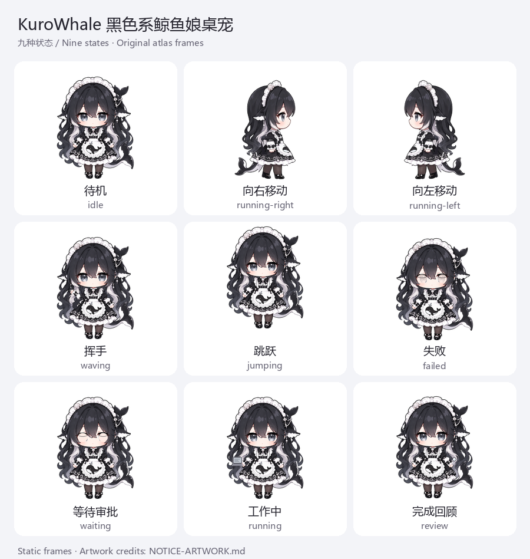

# KuroWhale 黑色系鲸鱼娘桌宠 🐳

[中文](README.md) | English

**A whale-girl desktop pet inspired by the official DeepSeek Harness icon.** KuroWhale keeps you company on Windows and reacts to DSH Agent activity.

[GitHub repository](https://github.com/lemonxiny55/dsh-kurowhale-pet) · **DSH Desktop → Add plugin: `dsh-kurowhale-pet@0.3.0`** · [DSH Market](https://awesome-dsh-plugin.com/p/lemonxiny55/dsh-kurowhale-pet/)

This is a free, unofficial community project. It is not affiliated with or endorsed by DeepSeek or the related creators.

## Installation

Requires **Windows x64, WebView2, and DSH Desktop (`>=0.2.1-rc.3`, without an artificial upper cap, supporting `0.2.3-alpha.2` and future updates)**.

1. Open **Plugin management → Add plugin** in DSH Desktop.
2. Enter `dsh-kurowhale-pet@0.3.0` (or previous `0.2.0`), select the **official npm registry**, and click **Install**.
3. Click **Enable now** when installation finishes, then restart DSH.

The first launch prefers bundled artwork. Missing artwork and the official Neutralino 6.9.0 runtime are downloaded from pinned sources with mirror fallback and verified with SHA-256. Existing custom paths, visibility preferences, and position are retained. Download or verification failures are logged while DSH remains usable. Desktop requires uninstalling a same-name plugin before reinstalling it; back up your configuration first.

**v0.3.0 release info:** [GitHub Release](https://github.com/lemonxiny55/dsh-kurowhale-pet/releases) · [Bilingual release notes](docs/RELEASE-NOTES-0.3.0.md) · [npm](https://www.npmjs.com/package/dsh-kurowhale-pet)

| Installation entry | Action | Verification |
| --- | --- | --- |
| DSH Desktop (npm) | Add `dsh-kurowhale-pet@0.3.0`, enable, and restart | 0.3.0 passed 39 Node unit tests, 2 bundle tests, 1 upgrade/rollback test, standalone Neutralino 6.9.0 interactive visual verification, and upstream catalog checks; available via npm once published. |
| GitHub repository | Enter `https://github.com/lemonxiny55/dsh-kurowhale-pet` in Add plugin, enable, and restart | Previously verified via CLI and visible after rc.5 restart; GitHub URL installation through the add-plugin UI remains unverified. |
| DSH Market | Open Plugins → Discover and search for KuroWhale | 0.3.0 metadata passed upstream `buildMarketIndex` validation (`>=0.2.1-rc.3`, covering `0.2.1-rc.3` through `0.2.3-alpha.2` and future DSH updates); catalog sync follows npm publication. |

See the [post-release acceptance record](docs/POST-RELEASE-0.1.3.md) for historical index notes. The [Windows code bundle](docs/WINDOWS-INSTALL.md) remains an alternative requiring manual configuration.

## Features and preview

- **Twelve animation poses, lively autonomous idle routine & partitioned interactions:** idle, side-profile left/right turn/walk, waving, jumping, failure, awaiting approval, working (thinking, coding, shell commands, searching, collaboration), completion review, plus `v0.3.0` interactive poses (**`petted` head-pats, `dozing` sleepy nap, and `eating` dried fish snack**). Automatically cycles without consecutive repeats after a 6–10s startup warm-up and every 9–15s of idle across walking, snacking, dozing, happy tail-wags, hopping, and waving; also supports head-pat hover rub, head tap, body poke dodge, 4-click dizzy wobble, and Canvas heart/sparkle/`zZz` particles (gracefully compatible with custom 9-row skins).
- **Side-mounted frosted multi-session & approval floating card:** click the waiting capsule (or menu/tray/`/kurowhale panel`) to open a frosted floating card beside the character without covering her, inspect live sessions, `toolName`, and approval `reason`, and act via in-process `approval/request` racing (**Allow once**, **Reject**, **Stop turn** via `agent.cancel`, or **Focus DSH**) with zero HTTP ports and `0` security red lines.
- **Offline daily companion stats & gentle care reminders:** tracks daily companion time, completed turns, tool calls, approvals, and passive read-only token usage in `~/.dsh/kurowhale-pet/stats.json` (`/kurowhale stats`); fires 50-minute focus-break and once-per-night late-night care nudges only on return to idle (toggleable).
- **Smooth controls, side-mounted compact menu & slash commands:** flicker-free in-place scaling, autonomous patrol/naps, `hideWhenIdle` focus mode, bounded auto-restart, plus a compact 2-column right-click menu (`openBeside()`, quick-play strip, 4px subtle scrollbar), tray actions, and `/kurowhale` commands (`pet`, `feed`, `doze`, `cheer`, `panel`, `stats`, `approve`, `reject`, `stop`, `care`, etc.).
- **Mirror fallback with strict verification:** automatic runtime/asset downloads support mirror fallback while enforcing SHA-256 verification.

View all nine states (static frames from the v0.2.0 animation atlas)

Extracted and arranged from the `v0.2.0` `spritesheet.webp`. See [artwork version maintenance](docs/ARTWORK-VERSIONS.md) for reproduction details.

## Verified scope

Installation and desktop interaction were verified on Windows x64 with DSH Desktop 0.2.1-rc.3; installation and targeted stability regression were also checked on rc.5. Other DSH versions, mixed-DPI setups, and long-running use have not been fully validated. See the [technical acceptance record](docs/TECHNICAL-ACCEPTANCE-0.1.0.md) and [this round's record](docs/POST-RELEASE-0.1.3.md) for evidence and limitations.

## Artwork and licensing

The character was created with **AI assistance** and developed into animated assets. Its references include a whale-girl image found through Google Images. That image closely resembles the character in [PC2005-cloud/dsh-pet](https://github.com/PC2005-cloud/dsh-pet), but its direct creator, original source, and permission scope are not fully confirmed. The reference image itself is not included in the release.

Thanks to [PC2005-cloud/dsh-pet](https://github.com/PC2005-cloud/dsh-pet) and the community creators, including [上善无形](https://space.bilibili.com/4456176), the creator of the prototype “溟月”, and [ZipZipPipe](https://space.bilibili.com/4168597), credited by dsh-pet for the community whale-maid redesign. See the [artwork notice](NOTICE-ARTWORK.md) for provenance and changes.

Code is licensed under [MIT](LICENSE). New artwork contributions that the project has the right to license are offered under [CC BY-NC-SA 4.0](LICENSE-ARTWORK): attribution, indication of changes, noncommercial use, and share-alike are required. This does not relicense independent third-party works. Please report provenance or licensing concerns via an [Issue](https://github.com/lemonxiny55/dsh-kurowhale-pet/issues).
