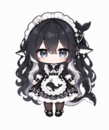
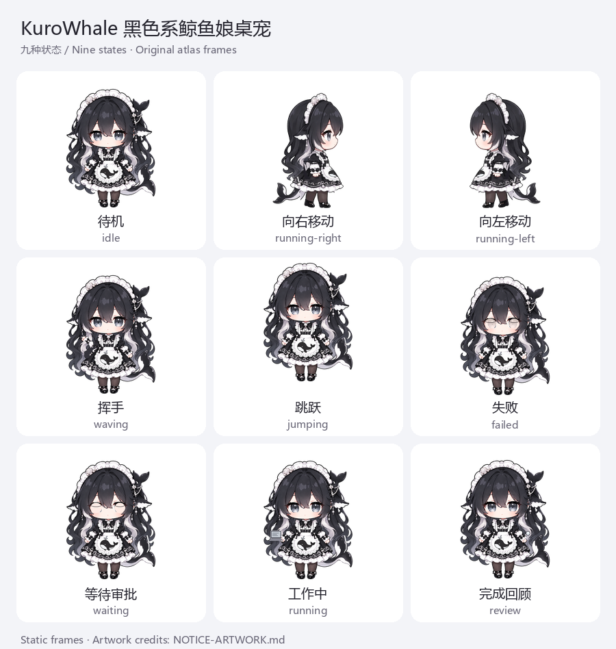

# KuroWhale 黑色系鲸鱼娘桌宠 🐳

中文 | [English](README.en.md)

**参考 DeepSeek Harness 官方图标设计的鲸鱼娘桌宠。** 在 Windows 桌面上陪伴你，并响应 DSH Agent 的工作状态。

[GitHub 仓库](https://github.com/lemonxiny55/dsh-kurowhale-pet) · **DSH Desktop 添加插件：`dsh-kurowhale-pet@0.4.0`** · [DSH Market](https://awesome-dsh-plugin.com/p/lemonxiny55/dsh-kurowhale-pet/)

免费、非官方社区项目，与 DeepSeek 官方及相关创作者无关联，也未获得其背书。

## 安装

需要 **Windows x64、WebView2 和 DSH Desktop（`>=0.2.1-rc.3`，不设人为上限，兼容 `0.2.3-alpha.2` 及后续更新）**。

1. 打开 DSH Desktop 的 **插件管理 → 添加插件**。
2. 输入 `dsh-kurowhale-pet@0.4.0`（或历史版本 `0.3.0`），选择 **npm 官方源**，点击 **安装**。
3. 安装完成后点击 **立即启用**，再重启 DSH。

首次启动会优先使用包内素材；缺失的素材和官方 Neutralino 6.9.0 运行时会从固定来源及镜像回退联网获取并逐文件校验 SHA-256。已有自定义路径、显示偏好和位置予以保留。下载或校验失败会记录错误，DSH 仍可使用。同名插件已安装时，Desktop 要求先卸载再安装，请先备份配置。

**v0.4.0 发布资料：**[GitHub Release](https://github.com/lemonxiny55/dsh-kurowhale-pet/releases) · [双语发布说明](docs/RELEASE-NOTES-0.4.0.md) · [皮肤包规范](docs/SKIN-PACK.md) · [npm](https://www.npmjs.com/package/dsh-kurowhale-pet)

| 安装入口 | 操作 | 验证情况 |
| --- | --- | --- |
| DSH Desktop（npm） | 添加 `dsh-kurowhale-pet@0.4.0`，立即启用后重启 | 0.4.0 已通过全量 Node 单元测试、发行包测试、升级回滚测试、皮肤包校验与上游市场索引校验；Windows 桌面真机目视验收见发布清单。 |
| GitHub 仓库 | 在“添加插件”中输入 `https://github.com/lemonxiny55/dsh-kurowhale-pet`，启用后重启 | 历史 CLI 安装和 rc.5 重启显示已验证；GitHub 地址的添加插件界面未单独验收。 |
| DSH Market | 插件 → 发现，搜索 KuroWhale | 0.4.0 元数据已通过上游 `buildMarketIndex` 校验（声明 `>=0.2.1-rc.3`，覆盖 `0.2.1-rc.3` 至 `0.2.3-alpha.2` 及后续更新）；线上市场目录随 npm 发布后上游扫描同步更新。 |

市场索引设置与历史验证见[发布后验收记录](docs/POST-RELEASE-0.1.3.md)。[Windows 纯代码包](docs/WINDOWS-INSTALL.md) 保留为人工配置备用方式。

## 功能与展示

- **混合 DPI 多屏自愈、智能鼠标穿透与脱敏诊断**：窗口位置升级为「显示器标识 + 工作区相对百分比锚点」（兼容旧版像素配置自动迁移），启动、切屏或显示器热插拔越界时自动吸附回主屏安全范围；支持「专注穿透模式」半透明常驻，遇到`等待审批`或`失败`时自动临时取消穿透并高亮唤醒，完成后自动恢复；托盘/菜单/`/kurowhale diag` 一键生成并复制自动脱敏的诊断信息。
- **全桌面轻提醒闭环与升级版霜白浮卡**：内置 Web Audio 分级轻提示音（`等待审批` / `完成回顾` / `失败`，支持一键静音与 `HH:MM-HH:MM` 勿扰时段）；DSH 失焦时弹出 Windows 原生 Toast 通知，点击直达浮卡或 DSH；霜白浮卡支持 3+ 活跃会话自动折叠展开，并优雅兼容 `question` 与 `plan-review` 入口；零新增 HTTP 端口，保持 `0` 安全红线。
- **工作攒小鱼干循环与 Vibe Coding 陪伴战报卡**：`stats.json` 平滑迁移支持自动攒取与喂鱼消耗小鱼干库存（库存为 0 也有俏皮互动）、连续陪伴天数与里程碑解锁粒子；浮卡与 `/kurowhale report` 支持本地 Canvas 生成黑蓝霜白极客风格今日/本周 PNG 战报卡，一键保存或复制到剪贴板。
- **十二组动作、高频自主生活循环与极简皮肤包热切换**：保留 12 组全彩互动姿态、分区交互与旧版 9 行自定义皮肤自动降级；支持选择本地 `skin-pack` 目录无重启热切换与自定义分级提示音，失败自动回滚默认皮肤，并提供 `npm run validate-skin` 校验脚本。

查看九种状态（v0.2.0 动画图集的静态帧）

使用 `v0.2.0` 图集 `spritesheet.webp` 提取并排版；制作与校验方式见[素材版本维护](docs/ARTWORK-VERSIONS.md)。

## 已验证范围

已在 Windows x64 的 DSH Desktop 0.2.1-rc.3 验证安装及桌宠交互，并在 rc.5 验证安装和针对性稳定性回归。其他 DSH 版本、混合 DPI 和长期运行尚未充分验证，具体证据与限制见[技术验收](docs/TECHNICAL-ACCEPTANCE-0.1.0.md)和[本轮记录](docs/POST-RELEASE-0.1.3.md)。

## 角色来源与许可

角色通过 **AI 辅助创作**并加工为动画。创作参考包括通过 Google 图片搜索找到的鲸鱼娘图片；该图片与 [PC2005-cloud/dsh-pet](https://github.com/PC2005-cloud/dsh-pet) 的角色高度相似，但其具体作者、原始发布页和授权范围尚未完全确认。参考原图不包含在发行包内。

感谢 [PC2005-cloud/dsh-pet](https://github.com/PC2005-cloud/dsh-pet) 及社区创作者，包括原型「溟月」的[上善无形](https://space.bilibili.com/4456176)、dsh-pet 所述女仆鲸鱼娘二次设计者 [ZipZipPipe](https://space.bilibili.com/4168597)。详细来源与改动见[美术署名](NOTICE-ARTWORK.md)。

代码采用 [MIT](LICENSE)；项目有权授权的新增美术贡献采用 [CC BY-NC-SA 4.0](LICENSE-ARTWORK)，要求署名、注明修改、非商业使用及相同方式共享，不重新授权第三方独立作品。来源或授权问题欢迎通过 [Issue](https://github.com/lemonxiny55/dsh-kurowhale-pet/issues) 联系。
