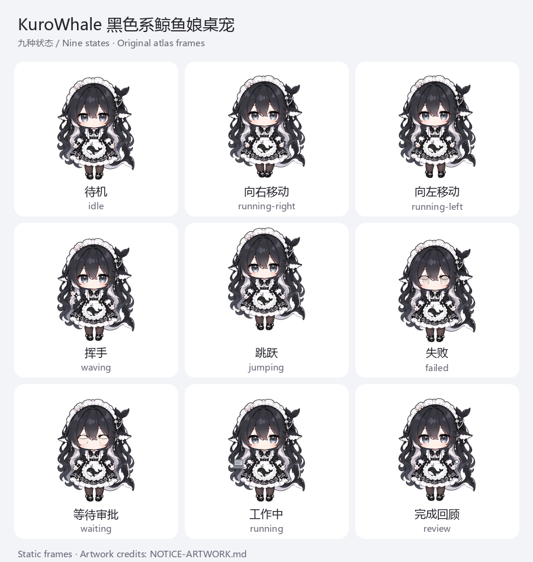

# KuroWhale 黑色系鲸鱼娘桌宠 🐳

中文 | [English](README.en.md)

**参考 DeepSeek Harness 官方图标设计的鲸鱼娘桌宠。** 在 Windows 桌面上陪伴你，并响应 DSH Agent 的工作状态。

[GitHub 仓库](https://github.com/lemonxiny55/dsh-kurowhale-pet) · **DSH Desktop 添加插件：`dsh-kurowhale-pet@0.1.3`** · [DSH Market](https://awesome-dsh-plugin.com/p/lemonxiny55/dsh-kurowhale-pet/)

免费、非官方社区项目，与 DeepSeek 官方及相关创作者无关联，也未获得其背书。

## 安装

需要 **Windows x64、WebView2 和 DSH Desktop 0.2.1-rc.3 或 rc.5**。

1. 打开 DSH Desktop 的 **插件管理 → 添加插件**。
2. 输入 `dsh-kurowhale-pet@0.1.3`，选择 **npm 官方源**，点击 **安装**。
3. 安装完成后点击 **立即启用**，再重启 DSH。

首次启动会优先使用包内素材；缺失的素材和官方 Neutralino 6.9.0 运行时会从固定来源联网获取并校验 SHA-256。已有自定义路径、显示偏好和位置予以保留。下载或校验失败会记录错误，DSH 仍可使用。同名插件已安装时，Desktop 要求先卸载再安装，请先备份配置。

**v0.1.3 已发布：**[npm](https://www.npmjs.com/package/dsh-kurowhale-pet/v/0.1.3) · [GitHub Release](https://github.com/lemonxiny55/dsh-kurowhale-pet/releases/tag/v0.1.3) · [双语发布说明](docs/RELEASE-NOTES-0.1.3.md)

| 安装入口 | 操作 | 验证情况 |
| --- | --- | --- |
| GitHub 仓库 | 在“添加插件”中输入 `https://github.com/lemonxiny55/dsh-kurowhale-pet`，启用后重启 | 历史 CLI 安装和 rc.5 重启显示已验证；GitHub 地址的添加插件界面未单独验收。 |
| DSH Desktop（推荐） | 添加 `dsh-kurowhale-pet@0.1.3`，立即启用后重启 | 0.1.3 最终包此前已通过 rc.5 隔离安装及原生显示；本轮官方源界面安装、启用和渲染器就绪通过，未目视复验。 |
| DSH Market | 插件 → 发现，搜索 KuroWhale | **安装仍受阻。** PR #10554 已合并，但 2026-10-31 在线索引仍为 0.1.1、旧简介和通用图标；rc.5 显示“不兼容”并禁用安装按钮。当前请使用上面的固定 npm 版本入口。 |

市场索引设置、同步问题的定位和本轮验收边界见[发布后验收记录](docs/POST-RELEASE-0.1.3.md)。[Windows v0.1.0 ZIP](docs/WINDOWS-FULL-INSTALL.md) 保留为需要人工配置的历史备用方式。

## 功能与展示

- **九种动画**：待机、左右移动、挥手、跳跃、失败、等待审批、工作中和完成回顾。
- **桌面悬浮**：透明窗口支持拖动、缩放、隐藏、置顶和位置记忆。
- **菜单与托盘**：右键管理桌宠，通过系统托盘恢复显示。

查看九种状态（现有动画图集的静态帧）

使用原有 `pet.json` 指向的 `spritesheet.webp` 提取并排版，未重绘角色或修改动画；制作方式见[素材版本维护](docs/ARTWORK-VERSIONS.md)。

## 已验证范围

已在 Windows x64 的 DSH Desktop 0.2.1-rc.3 验证安装及桌宠交互，并在 rc.5 验证安装和针对性稳定性回归。其他 DSH 版本、混合 DPI 和长期运行尚未充分验证，具体证据与限制见[技术验收](docs/TECHNICAL-ACCEPTANCE-0.1.0.md)和[本轮记录](docs/POST-RELEASE-0.1.3.md)。

## 角色来源与许可

角色通过 **AI 辅助创作**并加工为动画。创作参考包括通过 Google 图片搜索找到的鲸鱼娘图片；该图片与 [PC2005-cloud/dsh-pet](https://github.com/PC2005-cloud/dsh-pet) 的角色高度相似，但其具体作者、原始发布页和授权范围尚未完全确认。参考原图不包含在发行包内。

感谢 [PC2005-cloud/dsh-pet](https://github.com/PC2005-cloud/dsh-pet) 及社区创作者，包括原型「溟月」的[上善无形](https://space.bilibili.com/4456176)、dsh-pet 所述女仆鲸鱼娘二次设计者 [ZipZipPipe](https://space.bilibili.com/4168597)。详细来源与改动见[美术署名](NOTICE-ARTWORK.md)。

代码采用 [MIT](LICENSE)；项目有权授权的新增美术贡献采用 [CC BY-NC-SA 4.0](LICENSE-ARTWORK)，要求署名、注明修改、非商业使用及相同方式共享，不重新授权第三方独立作品。来源或授权问题欢迎通过 [Issue](https://github.com/lemonxiny55/dsh-kurowhale-pet/issues) 联系。
